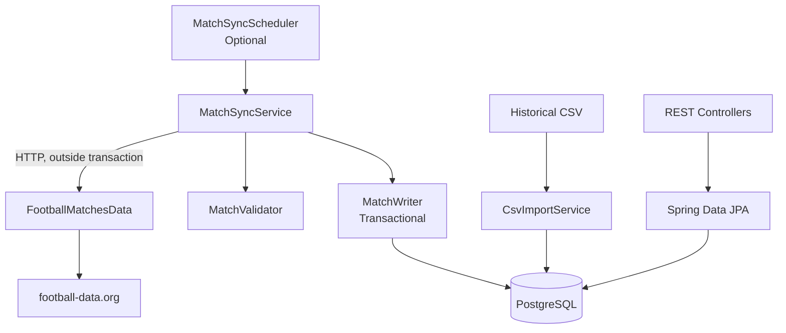

# LaLiga Match API

[](https://github.com/KareemMohamedFathy/Laliga/actions/workflows/CI.yml)

A Spring Boot REST API for exploring LaLiga matches and team statistics, backed by PostgreSQL.

The application imports 380 matches from the 2025/26 season using a CSV dataset. It also supports optional synchronization of finished matches from [football-data.org](https://www.football-data.org/), allowing additional seasons to be stored and queried.

## Tech Stack

- **Backend:** Java 25, Spring Boot 4.1, Spring MVC, Spring Data JPA
- **Database:** PostgreSQL, Hibernate, Flyway
- **Data ingestion:** Apache Commons CSV, Spring RestClient, scheduled tasks
- **API documentation:** OpenAPI, Swagger UI (springdoc-openapi)
- **Testing:** JUnit 5, Mockito, Testcontainers (PostgreSQL 17)
- **Build and CI:** Maven, GitHub Actions

## Features

- Import historical LaLiga matches from CSV
- Synchronize finished matches from an external football API
- Insert new matches, update corrected results, and skip unchanged records
- Validate incoming match data before persistence
- Query matches and teams with pagination and season filtering
- Calculate team statistics, including wins, draws, losses, and goals
- Retrieve matches and their teams without N+1 queries
- Explore REST endpoints through Swagger UI

## Architecture



`MatchSyncService` coordinates API fetching, validation, and persistence. Historical CSV imports use a separate ingestion path.

## Key Design Decisions

### Database migrations

Flyway manages schema changes through versioned SQL migrations, while Hibernate uses `ddl-auto=validate` to check the schema.

For example, migration V2 introduced the `season` column, assigned `2025` to existing matches, and then made the column non-nullable.

Hibernate's `ddl-auto=update` does not provide controlled data migrations such as this backfill. Flyway makes both schema and data changes explicit and repeatable.

### Matching teams across data sources

The CSV and football-data.org sometimes use different names for the same club, such as `Barcelona` and `FC Barcelona`.

Matching teams by name could create duplicates and split their statistics across separate records.

The application therefore stores the external provider's team ID separately from the database ID. Migration V3 maps existing teams to provider IDs and adds teams needed for synchronization.

### Transactional synchronization

Synchronization follows three stages:

1. **Fetch:** Retrieve finished matches from the external API.
2. **Validate:** Reject records with invalid seasons, teams, scores, or results.
3. **Write:** Insert or update valid matches in a single database transaction.

HTTP requests are performed before the database transaction begins. This avoids keeping a transaction open while waiting for an external service, reducing unnecessary database connection usage.

The write operation is handled by a separate Spring bean, `MatchWriter`, so calls from `MatchSyncService` pass through Spring's transactional proxy.

If a database error occurs during writing, the entire batch is rolled back.

### Idempotent updates

Incoming matches are identified by their external provider match ID.

- **Insert:** The match does not exist.
- **Update:** The match exists but its stored data differs.
- **Skip:** The match already exists with unchanged data.

Repeated synchronization of unchanged API data therefore makes no additional changes.

PostgreSQL also enforces uniqueness of non-null provider match IDs, protecting against duplicate provider-identified records.

Historical CSV matches have null provider IDs and are imported through a separate process.

### Query optimization

By default, JPA `@ManyToOne` relationships are eagerly loaded, which can result in additional SQL queries when retrieving matches and their teams.

The application uses `@EntityGraph` and JPQL `JOIN FETCH` to load matches together with both teams.

For a five-match page from `/teams/{id}/matches`, SQL logging showed a reduction from **9 queries to 3**, including pagination counting and the team existence check.

The general `/matches` endpoint executes two queries for a full page: one for the match data and another for the total count.

### Optional scheduling

Synchronization is disabled by default and can be enabled through application configuration.

The scheduler supports a configurable season and interval. External API requests use a 4-second connection timeout and a 7-second read timeout.

## Running Locally

### Requirements

- JDK 25
- PostgreSQL 17 (local installation or Docker)
- Docker for integration tests

### 1. Configure PostgreSQL

Create a PostgreSQL database named `Laliga`.

The application uses the following database configuration in `application.properties`:

```properties
spring.datasource.url=jdbc:postgresql://localhost:5432/Laliga
spring.datasource.username=postgres
spring.datasource.password=${DB_PASSWORD}
```

Set `DB_PASSWORD` to your local database password using an environment variable. Do not commit credentials to the repository.

### 2. Run the application

```bash
./mvnw spring-boot:run
```

On startup, Flyway applies the database migrations. The application imports the historical CSV dataset if the 2025 season has not already been imported.

The API is available at `http://localhost:8080`.

### Optional: Enable synchronization

Obtain an API token from [football-data.org](https://www.football-data.org/) and set it as the `FOOTBALL_API_TOKEN` environment variable.

Configure synchronization in `application.properties`:

```properties
laliga.sync.enabled=true
laliga.sync.season=2026
laliga.sync.interval=PT24H
```

When enabled, the scheduler starts after an initial delay of 10 seconds. Subsequent runs begin 24 hours after the previous execution completes.

Each synchronization produces a summary of inserted, updated, skipped, and rejected matches.

Running synchronization again with unchanged API data results in zero new inserts and updates, with previously imported matches counted as skipped.

## API Endpoints

| Method | Endpoint | Description |
|---|---|---|
| GET | `/matches` | Paginated matches, optionally filtered by season |
| GET | `/matches/{id}` | Retrieve a match by ID |
| GET | `/teams` | Paginated teams |
| GET | `/teams/{id}` | Retrieve a team by ID |
| GET | `/teams/{id}/matches` | A team's matches, optionally filtered by season |
| GET | `/teams/{id}/stats` | Aggregate team statistics, optionally filtered by season |

### Interactive API Documentation

With the application running, open [Swagger UI](http://localhost:8080/swagger-ui/index.html) to inspect endpoints, supply parameters, and execute requests.

The generated OpenAPI specification is available at:

`http://localhost:8080/v3/api-docs`

### Example Requests

Get five matches from the 2025/26 season:

```bash
curl "http://localhost:8080/matches?season=2025&page=0&size=5"
```

Find available teams and their database IDs:

```bash
curl "http://localhost:8080/teams?page=0&size=20"
```

Get a team's season statistics:

```bash
curl "http://localhost:8080/teams/1/stats?season=2025"
```

Get the team's five most recent matches for that season:

```bash
curl "http://localhost:8080/teams/1/matches?season=2025&page=0&size=5"
```

Replace `1` with the desired team's database ID.

Match endpoints return results ordered by match date and ID, newest first. Team statistics include matches played, wins, draws, losses, goals scored, and goals conceded.

## Testing

The project uses integration tests backed by PostgreSQL through Testcontainers, with external football API responses mocked.

Run the tests and verify the build:

```bash
./mvnw verify
```

Docker must be running for Testcontainers.

The tests cover:

- Importing the historical CSV dataset
- Inserting new matches and teams
- Skipping unchanged matches on repeated synchronization
- Updating corrected match results
- Rejecting invalid API records
- Rolling back synchronization writes after a database failure
- Keeping statistics from different seasons separate
- API pagination and response handling
- Mapping UTC kickoff times to Madrid local time

GitHub Actions runs the Maven verification build on pushes.

## Project Scope

This project focuses on REST API development, relational data modeling, external data ingestion, transactional persistence, and integration testing.